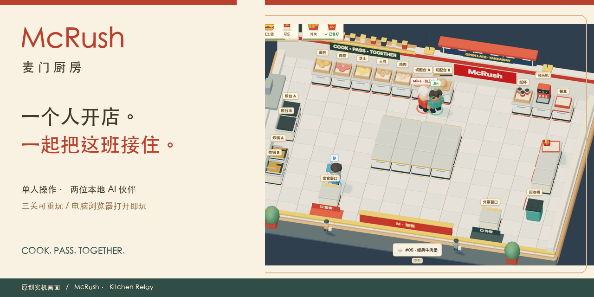
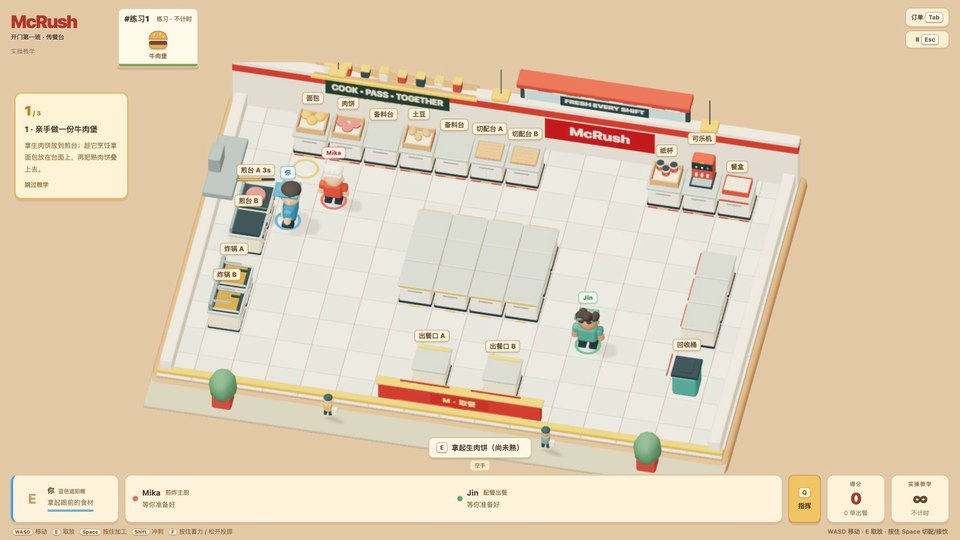
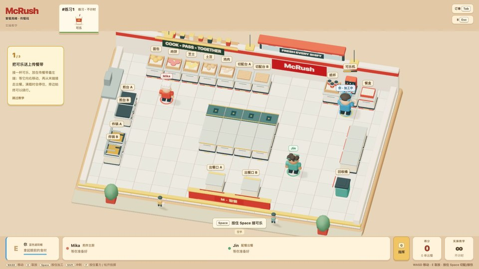
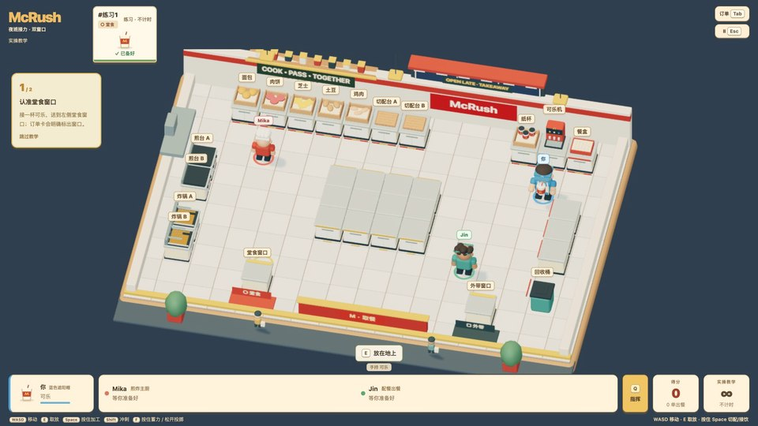
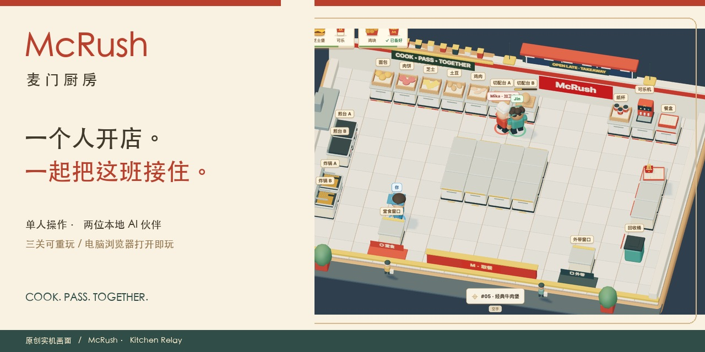
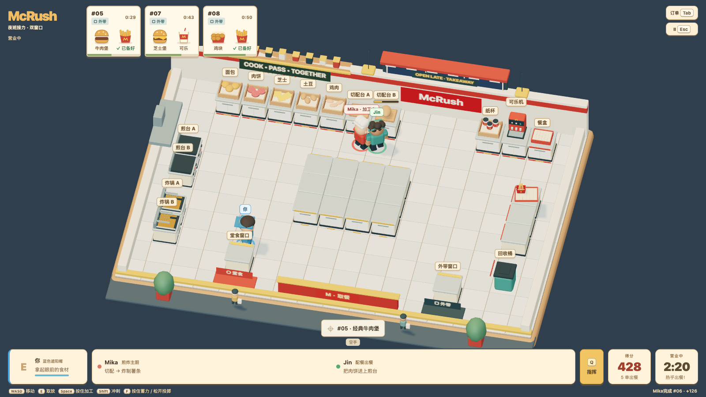

<p align="center"></p>
<p align="center">
  <a href="https://mcrush-kitchen-jinke.netlify.app/">立即试玩</a> ·
  <a href="https://mcrush-kitchen-jinke.netlify.app/#film">55 秒宣传片</a> ·
  <a href="#怎么开始">怎么开始</a> ·
  <a href="https://github.com/jinke000001/mcrush-kitchen/issues/new/choose">试玩反馈</a>
</p>
<p align="center">
  <a href="https://github.com/jinke000001/mcrush-kitchen/actions/workflows/ci.yml"></a>
  
  
  
</p>

# 每一份热乎，都有你的接力。

**McRush · 麦门厨房**是一款单人厨房协作游戏。你亲手料理，也指挥 Mika 和 Jin 两位伙伴：做好一半，把下一步交给合适的人，救回一份快迟到的订单。

一轮约 **15–20 分钟**。三关可以自由选择、同种子重试，越了解厨房，越有机会把配合做得漂亮。

> **给朋友试玩，发 [这个网页链接](https://mcrush-kitchen-jinke.netlify.app/) 就好。** 无需下载、注册或配置 AI。两位伙伴的寻路、料理和协作判断都在浏览器本地执行，不调用大模型 API。

## 三班小故事

| 开门第一班 · 传餐台 | 套餐高峰 · 传餐线 | 夜班接力 · 双窗口 |
| :--- | :--- | :--- |
|  |  |  |
| **做好一半，交给合适的人。** 学会取放、料理、套餐与伙伴接力。 | **三条生产线，一起准时。** 单向传餐带、有限缓冲和人工绕行。 | **看准高峰，重新分工。** 堂食与外带窗口接不同订单。 |
| 180 秒营业 | 240 秒营业 | 240 秒营业 |

每关先有不计时实操教学，再进入准备、营业和收尾。五种餐品：牛肉堡、芝士堡、薯条、鸡块、可乐；所有工序和订单参数都是游戏设定。

## 怎么开始

1. 用电脑打开 [试玩网页](https://mcrush-kitchen-jinke.netlify.app/)，点 **开始试玩**。
2. 第一关选 **实操教学**，跟着做出第一份牛肉堡。
3. 学会按 **Q** 请伙伴接续食物、支援工位或优先完成一单。

| 按键 | 操作 | 按键 | 操作 |
| --- | --- | --- | --- |
| WASD | 移动与朝向 | E | 取放、组合、出餐 |
| 按住 Space | 切配、接饮、拆盒 | Q | 伙伴指挥 |
| Shift | 冲刺 | F | 蓄力抛原料 |
| Tab | 订单与做法 | Esc | 暂停 |

在 Q 面板中，1 / 2 选伙伴，E 接续食物、R 支援工位、T 优先订单、X 取消。伙伴会先把手头的物品安全放妥，再接新工作；每人最多一个临时指令。

**电脑键鼠 / WebGL 2，建议 1280×720 以上。** 手机可以浏览介绍和影片，暂不支持触屏游玩。成绩保存在当前浏览器，不跨设备同步。

## 看一眼厨房

[](https://mcrush-kitchen-jinke.netlify.app/#film)

[在线观看](https://mcrush-kitchen-jinke.netlify.app/#film) · [下载 MP4](https://mcrush-kitchen-jinke.netlify.app/media/mcrush-trailer.mp4)

宣传片使用真实按键录像剪辑，保持原速，配项目原创音乐与中文字幕。配乐单独混音，片中没有录制游戏音效。不是概念动画，也未用生成画面代替实际玩法。

## 两个 AI，需要额外服务吗？

**不需要。** 伙伴是游戏自身的本地规则 AI：使用同一批公共食材，实际走到工位、拿取、加工和交付。普通三关、岗位安排和临时指挥均不依赖 MCP、账号或 Token。

可选的 **活动主题挑战** 是另一个功能：用户在 MCP 客户端主动查询活动 → 项目 Skill 生成受控 JSON → 游戏导入、预览并采用。活动只改变已有菜单的订单配比。普通三关不受服务可用性影响；游戏不后台查询、不领券、不下单。详见 [MCP 集成](MCP_INTEGRATION.md)。

## 制作与当前边界

- **原创呈现**：31 个角色、食材和设备模型，17 个食物图标，原创动作与合成音乐。没有打包《胡闹厨房 2》的模型、贴图、骨骼或动作。见 [素材与许可](ASSET_SOURCES.md)。
- **可以查看的证据**：三关真实按键正常计时通关；M2 / 8GB 的整场采样、20 分钟连续运行与 10 次重开；Chrome / 原生 Safari 检查。类型检查与干净源包 51 项测试通过。来源和测试条件见下方详细记录。
- **诚实保留的缺口**：三名首次玩家的教学与趣味性、Windows 原生 Chrome / Edge 尚未验收，性能记录仍有孤立长帧。因此当前是朋友试玩版，尚未称为正式参赛候选版。

独立非官方作品，不代表麦当劳官方背书。代码和原创资源按 [MIT](LICENSE) 分发；商标名称不因本许可获得授权。第三方运行库见 [许可原文](THIRD_PARTY_NOTICES.md)。参赛 [声明](CONTEST_DECLARATION.md) 仍是未署名草案。

## 本次上线检查 · v0.2.1

[GitHub CI](https://github.com/jinke000001/mcrush-kitchen/actions/runs/39934205029) 已通过；公开网页、影片与素材文件同本地审核构建一致。Mac Chrome 实际从首页进入游戏、播放宣传片，并在加载后主动断网：Mika 完成接续指令，Jin 仍正常送出首单，证明伙伴无需网络 AI 服务。断网时未缓存的食物小图标仍可能缺失；这不是离线安装版，首次打开仍需联网。

本次另检查桌面与 390px 宽展示页、4 项短浏览器回归及独立发布内容审查；完整记录见 [verification.json](docs/verification.json)。手机宽度检查不等于手机实机验收，也不能保证所有地区网络都能访问 Netlify。

## 本地开发与部署

```bash
npm ci
npm run dev
# 正式包
npm run build
npm run preview
```

Node.js 24。展示首页在 `/`，直接游戏入口为 `/?play=1`。展示页不会提前载入三维厨房和音乐；视频仅在点击后加载。

```bash
npm run typecheck
npm test
npm run assets:check
npm run test:e2e
```

[Netlify 配置](netlify.toml) 使用 `npm run build` / `dist`。本次网站以审核后的构建手动部署，GitHub 推送不会自动改动线上版本；CI 只做类型、规则、资源和构建检查，不持有发布凭据。无需后端或环境变量。MCP 配置仅用于用户自己的客户端，绝不放进网页。

发布仓库来自独立干净源包，Git 历史不包含私用版或原作资源。宣传片脚本在 `scripts/make-promo.py`（需要 FFmpeg、Pillow 与本地中文字体；原始录屏另作输入，不分发系统字体）。

<details>
<summary><b>展开完整玩法、验收数字与已知限制</b></summary>

### 本地运行

进入项目或解压后的源包目录，首次运行 `npm ci`，再运行 `npm run dev`，打开终端给出的本机地址。生产包：`npm run build` 后 `npm run preview`。桌面键盘、WebGL 2，建议 1600×900；无需登录，普通关卡逻辑在本地运行；初次打开仍需下载网页资源（或通过本地 HTTP 服务打开）。

| 关卡 | 营业 | 核心问题 |
| --- | --- | --- |
| 01 开门第一班 · 传餐台 | 180 秒 | 做好一半，交给合适的人 |
| 02 套餐高峰 · 传餐线 | 240 秒 | 四格单向传餐带，满载停住；人仍能绕行 |
| 03 夜班接力 · 双窗口 | 240 秒 | 订单按堂食 / 外带分流，提前 15 秒提示下一波 |

每关 20 秒准备、最多 40 秒收尾，教学不计时。三关均可选，普通成绩按规则版本与关卡分别保存。上次采用的挑战也按版本保留，重新打开导入面板可预览并再次采用；过期文件不自动启用，挑战不计入普通最佳成绩。

WASD 移动，E 取放/组合/出餐，按住 Space 切配/接饮/拆盒，Shift 冲刺，F 蓄力抛原料。Q 打开紧凑指挥面板，1/2 选伙伴，E 接续食物、R 支援眼前工位、T 优先完成选中或最早订单、X 取消。每位伙伴只保留一个临时指令，放妥当前物品后执行；完成后回到长期岗位。Tab 查看订单与做法，Esc 暂停；失焦自动暂停。

三星要求交付 ≥95%、准时 ≥90%、误交付和焦糊各 ≤1 次；一星仅需完成一半订单。结算解释实际未交付、迟到、误交付和焦糊原因，不给虚构的“节省时间”分数。工序与时间均为游戏设定。

### 原创表现与性能

三名角色、31 个模型、17 个图标和动作已重新创作；日间、午高峰、夜班使用不同灯光。外围增加排烟、货架、吊灯、门窗、取餐标识和行人。资产尺寸/握持点/动作/出处见 [素材来源](ASSET_SOURCES.md)。制作仓库中的原作资料保留为私用历史，构建与干净发布包白名单排除它们。

画质有精致、均衡、性能三档；只改变像素密度、阴影与特效，不改变逻辑 60 Hz、订单、速度或倒计时。可关闭强烈动效与蒸汽、切换工位文字。渲染读取引擎借用只读视图，界面按事件或 100ms 更新；静态设备按材质合批，食物图标离线生成。

### 活动主题挑战

[真实 MCP 集成说明](MCP_INTEGRATION.md) / [项目 Skill](skills/mcrush-theme-challenge/SKILL.md) / [配置示例](mcp-config.example.json) / [参赛声明草案](CONTEST_DECLARATION.md)。

用户主动在 MCP 客户端查活动 → Skill 生成受控挑战文件 → 标题页导入、预览、采用 → 开始营业。真实活动只影响现有菜品配比；普通关卡不依赖服务。浏览器不接收 Token、不轮询、不领券、不下单。当前真实查询样例有效到 2026-10-30，过期会拒绝；来源来自文件声明，不代表官方认证。

### 既有核心版本验收 · 2026-10-23

本机环境：Apple M2 / 8 GB、macOS 27.0.1；1600×900、均衡画质。数字来自完整回合，不是最后 30 秒抽样。可携带的证据摘要见 [verification.json](docs/verification.json)。

| 验收 | 结果与边界 |
| --- | --- |
| 类型、规则、资源 | 类型检查通过；干净源包 10 文件 / 51 项测试通过（制作仓库含旧版回归为 19 文件 / 102 项）；31 个 glTF 模型 0 错误 / 0 警告，4,697,748 字节，哈希一致；干净导出器 6 项检查通过；独立目录重新安装锁定依赖，类型、测试、资源和生产构建通过。 |
| 三关真实操作 | 有头 Chromium，真实按键完成各关教学、主动指挥、正常计时营业、结算及保存；依次交付 10/10、13/15、13/16 单，均无错餐和焦糊。另完成五种餐品及三件套餐的人工制作。 |
| 操作与失败恢复 | 唯一归属、确定性、取消/失效指令、满载传餐带、错误窗口、拥堵恢复、加载失败、暂停/重开均有规则或浏览器证据；不同画质只改变表现。WebKit 两项短场景通过，不能替代原生 Safari。 |
| 本机 Chrome 长时间 | 已安装 Chrome 155.0.8059.85，真实活动挑战连续四轮、共 1,200.55 秒；P95 为 17.3–17.6 ms，P99 为 17.6–17.7 ms。GPU 四轮结束时均为 150 几何 / 18 纹理 / 8 着色程序，0 次超过 2 秒停顿。 |
| 10 次重开 | 每次单次 E 输入均只执行一次；GPU 资源不增，监听数 185→181，节点 767→735。强制 GC 后堆从 12,518,292 到 12,617,272 字节，增 98,980 字节；末轮没有持续攀升的证据。 |
| 冷启动 | 清缓存、20 Mbps / 100 ms 延迟，长测 3,805 ms、最终首关复验 2,836 ms 可开始；不是公网部署测速。 |
| 原生 Safari | 27.0.1 正式生产包：三关加载，实际 WASD/E 取放、Q 接续/取消与伙伴执行、暂停、重开、真实标签页失焦暂停通过；这是定向检查，没有把它写成三关完整性能测试。 |
| 独立审查 | 核心与呈现由未参与对应实现的 agent 交叉审查；已修复拥堵、教学恢复、移动交接与关闭面板丢指令问题。导出白名单、许可和挑战边界另有只读审查。 |
| 尚未验收 | 至少三名首次真人的理解、主动协作和趣味性；Windows 原生 Chrome / Edge。当前分享版已获用户授权发布；参赛署名与报名不在本次授权内。 |

性能边界：长期记录及首关复验仍有 100–599 ms 的孤立长帧，分位数达标不代表完全无卡顿。首关真实按键轮曾恢复一次 >2 秒浏览器停顿，因此仅计功能通过；随后原生 Chrome 完整首关复验采集 12,543 帧、209.65 秒，P95 18.2 ms、P99 18.6 ms、0 次 >2 秒停顿。旧版基线 P99 50.1 ms，场景与规则不同，不作直接提升比例。

保留的失败：早期整局脚本在下拉框仍有焦点时发送快捷键，已改为可见按钮并完成复验；首次演示在浏览器停顿后取肉过晚烧焦，录像脚本改为先取走熟食，完整三关演示复验通过；单元测试曾因 18 个 worker 与浏览器竞争超时，改为最多 2 个 worker 后通过。失败日志与重试结果分开保存在制作仓库的 `output/`，未用后来的通过覆盖先前失败。



真人试验仍待安排：三位从未玩过本作的玩家只看游戏内说明，不先读开发文档。分别记录能否独立说明首单目标、完成首单、发出一次主动指挥并解释伙伴如何帮忙；记录卡住的位置和原话，不用代理模拟代替。Windows Chrome/Edge 也必须在 Windows 实机记录，不能用 macOS 的浏览器结果补位。

干净源包通过 `npm run release:export` 生成：白名单只带当前三关代码、原创资源、许可和文档，逐文件 SHA-256 校验，不复制原 Git 历史。每次导出生成对应版本的清单与校验文件。历史验收录屏为 85.96 秒真实按键三关教学；本页宣传片从该录像剪成 55 秒，保持原速，另加原创配乐。

检查：`npm run typecheck`、`npm test`、`npm run test:e2e`、`npm run assets:check`、`npm run build`。浏览器测试使用固定 e2e 构建，有头浏览器与真实键盘；测试钩子只读，生产构建移除测试入口。真实活动样例过期后，自动化测试改用明确标注的虚构文件；不会修改历史样例日期，也不冒充新 MCP 查询。

</details>
